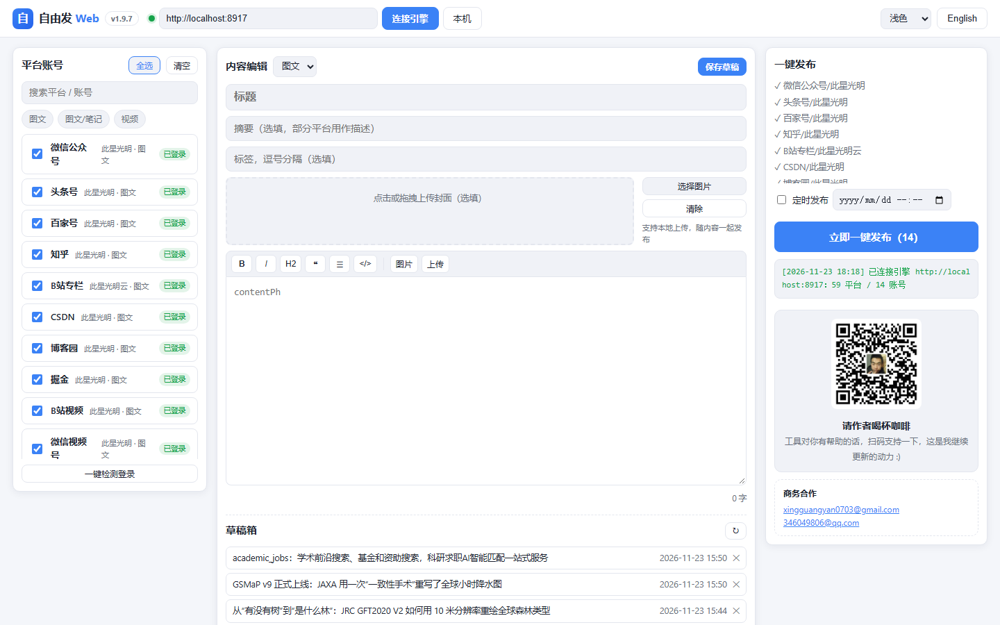

# 自由发 · Freeflow

### Multi-platform publishing tool for creators · Runs locally · Free & open source

**[中文文档](README_CN.md)** · English

> China mirror: [gitcode.com/qq_31988139/freeflow](https://gitcode.com/qq_31988139/freeflow)


Freeflow drives **your own accounts** through browser automation. It cracks nothing, routes nothing through third-party servers, and keeps every login state, asset, and publish record on your own machine.

---

## Latest release: v1.9.8

**v1.9.8 highlights**

- **Public web edition**: the web UI is now a real public site anyone can open — <https://xingguangyan.github.io/freeflow/> (auto-deployed from every release tag). It keeps working in **standalone mode** for first-time visitors (write, browser-local drafts, export Markdown/HTML) and switches to full publishing the moment you point it at your own desktop engine. A ready-to-upload ModelScope Space wrapper is included under `modelspace/` for a China-hosted mirror
- **Website flow**: landing hero with a "how to use" guide, engine-connection bar with status, standalone/connected mode badge

- **Cross-platform image garbling fixed**: pasted images used to show up as broken pictures or a wall of base64 letters on several platforms. Two-layer cleanup now: Markdown payloads strip `data:` / local image links (`sanitizeMdImages`), and after filling, a page-wide scan (`fixImageLinks`, main document + every iframe) replaces any `` still pointing at a local path or `data:` URI with a placeholder — with an explicit warning so you can re-upload manually
- **v1.9.5 carried over**: DOM-state login polling (no fixed 5s wait), rewritten adapters for Tencent Cloud / Huawei Cloud / 51CTO / Aliyun editors (Monaco `div.cm-content`, iframe `body[contenteditable]`, plain textarea), externalized selector configs under `platforms/*.json`, read-back verification after publishing
- **Business inquiries entry**: a "Business inquiries" block in the sidebar with two `mailto:` links
- **README / Release policy**: README keeps only the current release notes, install & usage, and business contact; all older release notes live in [Releases](https://github.com/xingguangYan/freeflow/releases)

**v1.9.7 highlights**

- **Cloud platform login false-positive fixed (the big one)**: Tencent Cloud / Aliyun / 51CTO / Huawei Cloud used to see the login window close before you finished logging in. Root cause: their `loggedInUrl` pattern also matched the login page itself, so the very first polling tick declared success. Login detection is now layered — auth-path URLs are rejected outright; the target editor's key elements (`loginSuccessSelectors`) are the strongest positive signal; a `loggedInUrl` match only counts when the page's "Log in" entry button is gone; user-chrome signals (avatar / log-out) come next; the cookie fallback now requires **every** declared cookie (a WAF session cookie alone no longer counts). Login pages now point at the real auth pages (`cloud.tencent.com/login`, `account.aliyun.com/login/login.htm`, `blog.51cto.com/login`)
- **New web edition**: open `http://<desktop-IP>:8917/web` from any browser on the same network — full one-click publishing UI with local image upload (drag & drop cover, insert images into the body), drafts, publish scheduling, live publish log, i18n (Chinese/English) and five themes. Alipay donation QR and business contact included
- **Publish login flow**: publishing now uses the DOM-state login waiter that opens a separate detection tab and closes it the moment login is detected, instead of reusing the publish window
- Regression: 13 new login-detection tests (`tools/test-login.js`); full suite green



> Older release notes: [GitHub Releases](https://github.com/xingguangYan/freeflow/releases).

---

## Key features

- **Fully local**: no cloud backend; login states and content stay on your machine
- **Operates your own accounts**: publishes by automating each platform's own web editor; nothing is cracked
- **59 platforms**: 44 Chinese + 15 overseas (incl. Huawei Cloud / Tencent Cloud / Aliyun / 51CTO / OSChina / InfoQ developer blogs)
- **Built-in browser core**: no system Chrome required — unzip and run
- **Web edition**: any browser on the LAN can drive the desktop engine at `http://<desktop-IP>:8917/web`
- **Three-tier fallback**: platform selectors → generic heuristics → clipboard manual mode, always with an explicit failure message
- **Free & open source**: MIT license

---

## Platform coverage

- **Chinese article (30)**: WeChat Official Account, Toutiao, Baijiahao, Zhihu, Xiaohongshu, Bilibili Columns, Jianshu, CSDN, Weibo, Sohu, NetEase, Dayuhao, Yidian, Sina Kandian, Kuaichuan, Dongfang, Phoenix, Meipian, Autohome, CNBlogs, Juejin, SegmentFault, Baidu Tieba, Xueqiu, Douban, Huawei Cloud Dev, Tencent Cloud Dev, Aliyun Dev, 51CTO, OSChina, InfoQ
- **Chinese video (13)**: Douyin, Kuaishou, Bilibili Video, Xigua, Haokan, WeChat Channels, Zhihu Video, iQIYI, Penguin, Sohu Video, AcFun, Youku, Weibo Video
- **Overseas (15)**: Medium, Dev.to, LinkedIn, Reddit, Hashnode, Substack, Tumblr, Pinterest, X, Facebook, YouTube, TikTok, Vimeo, Dailymotion, Instagram

Per-platform entries, login requirements and verification status: [PLATFORM_MATRIX.md](PLATFORM_MATRIX.md).

---

## Download & install

### Windows

Get `freeflow-win64.zip` from [Releases](https://github.com/xingguangYan/freeflow/releases/latest), unzip and run `自由发\自由发.exe`. Portable, with the browser core bundled.

### macOS

- Apple Silicon: `freeflow-mac-arm64.zip` / `.dmg`
- Intel: `freeflow-mac-x64.zip` / `.dmg`

If macOS blocks the first launch: right-click the app → Open, or run `xattr -cr /Applications/自由发.app`.

### Android / iOS

- Android: `freeflow-android.apk`, allow unknown-source installs
- iOS: `freeflow-ios.ipa`, sign with Sideloadly / AltStore (free signing lasts 7 days)

The phone build is a "pocket editor + remote": join the same Wi-Fi and enter the desktop address (e.g. `192.168.1.10:8917`) in the status pill; accounts and publishing run on the desktop engine.

### Web edition (v1.9.7+)

The public website: **<https://xingguangyan.github.io/freeflow/>** — open it from any browser, no install needed. It works standalone (write, browser-local drafts, Markdown/HTML export); to publish, connect it to your running desktop engine with the bar at the top — `http://localhost:8917` on the same machine, `http://<desktop-IP>:8917` from another device on the LAN. Execution still happens on the desktop engine, so all login states stay on your machine.

China-hosted mirror (ModelScope): a ready-to-upload Space wrapper lives under `modelspace/` — create a Gradio Space at <https://modelscope.cn/studio> with your account, upload the three files plus the `web/` folder, and it goes live on a `modelscope.cn` URL. Updates: re-upload `modelspace/web/`.

Self-host note: with the desktop app running it's also served directly at `http://<desktop-IP>:8917/web` on your network.

### Run from source

```bash
git clone https://github.com/xingguangYan/freeflow.git
cd freeflow
npm install
npm run pack
```

Requires Node.js 20+.

---

## Quick start

1. **Log in**: Accounts tab → pick a platform → add account → scan the QR code
2. **Write**: Articles tab, choose article / video / audio, write in rich text or Markdown
3. **Publish**: tick target accounts → preview → publish now or schedule
4. **Semi-automatic platforms**: a few (e.g. WeChat Official Account) need the final click/QR confirm from you

---

## Data directory & upgrades

All user data (login states, cookies, drafts, assets, task history, configs) lives in the `data/` folder next to the app. Upgrading replaces program files only — **never delete `data/`**; the whole folder is portable.

---

## Business inquiries

- [xingguangyan0703@gmail.com](mailto:xingguangyan0703@gmail.com)
- [346049806@qq.com](mailto:346049806@qq.com)

Platform adapters, bug reports, custom development, teams and private deployments are all welcome by email.

---

## Legal & boundaries

- Only operate accounts you own or are authorized to operate
- Some platforms' terms of service restrict automation; you use this tool at your own risk
- No cracked code or authorization from any commercial software
- Assets and text remain the property of their authors

---

## License

MIT License · Copyright (c) 2025 xingguangYan
