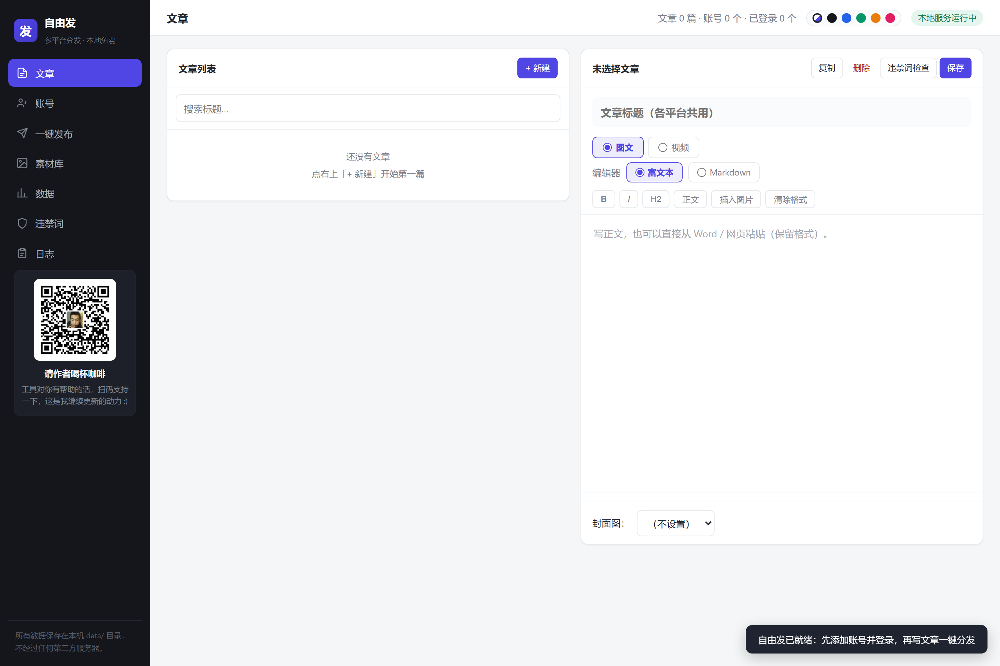
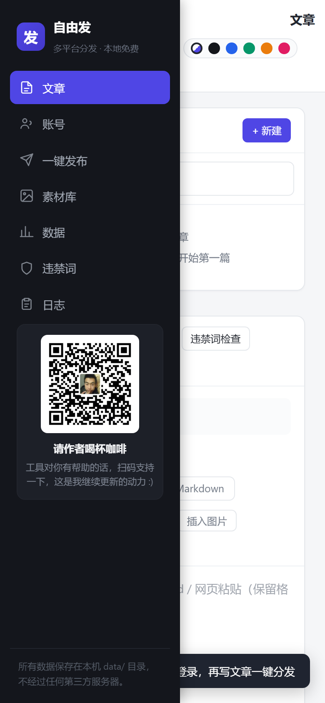
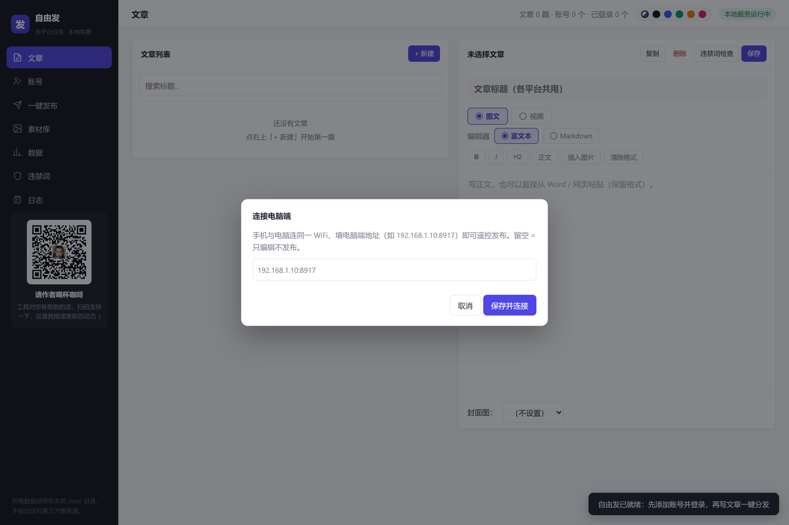

# 自由发 · Freeflow

### 自媒体多平台分发工具 · 本地运行 · 免费开源

**[English](README.md)** · 中文

用浏览器自动化操作**你自己的账号**。不破解任何软件，不经过任何第三方服务器，所有登录态、素材和发布记录都保存在本机。已打包为独立 Windows 程序，免安装。
（v1.4 起同时提供 macOS 版，见下方「macOS 版本」。）


---

---

## v1.9.1 更新（消息中心 · 中英文切换 · 检查更新）

- **统一消息中心**：左侧栏「消息中心」聚合各平台私信 / 评论 / 系统通知，支持按平台、类型、未读状态筛选；可直接回复并同步发送到源平台（发送前显示目标平台和账号，失败自动保留草稿可重试；不支持自动回复的平台会明确提示，绝不伪造成功）
- **中英文一键切换**：顶栏语言按钮（EN / 中文），界面全部文案切换并记住选择；动态渲染的内容也会自动进入翻译管线
- **软件内检查更新**：顶栏「检查更新」按钮 + 每次启动自动检测 GitHub Release，有新版本时弹窗展示本次更新内容，点「前往下载」直接跳转 Release 页
- **数据采集走创作数据中心**：知乎 / CSDN / B站等 16 个平台改从官方「创作数据中心」页面采集粉丝、阅读、点赞等指标，识别更准
- **趋势图按平台切换**：指标趋势面板支持切换不同平台或汇总全部，按天分桶聚合该平台下全部账号
- **大模型结果双视图**：生成结果支持「预览（渲染 HTML）/ 编辑源码」切换，自动剥离代码围栏、裸文本自动转 HTML

## v1.9 更新（我的大模型 · 多厂商 API 一键接入）

- **「我的大模型」模块**：左侧栏新增「我的大模型」，参考 Codex++ 的模型配置交互，支持导入自己的大语言模型辅助创作
  - **9 个厂商预设**：OpenAI、DeepSeek、通义千问、智谱 GLM、Kimi、豆包、Google Gemini、Ollama 本地、硅基流动——选厂商自动填好服务地址和常用模型列表，也可完全自定义任意 OpenAI 兼容端点
  - **每个模型独立保存**：温度、最大长度、系统提示词（写作人设）随配置存储，多模型互不污染；API Key 只存本机、前端永远打码显示
  - **连通性测试 / 拉取模型列表**：保存前后都能测连通、拉远端可用模型，拉到的模型点选即填入
  - **本地素材当上下文**：选择本地 txt / md / json / csv 等文本文件作为创作素材（只读取你选的文件，可随时删除撤回），生成时自动作为参考内容
  - **生成 → 预览 → 草稿箱 → 发布**：生成结果可编辑标题正文，一键存入草稿箱，或直接跳「一键发布」选平台分发
  - **安全边界**：未配置模型时不消费任何 API；失败明确报错（HTTP 状态 + 原因），绝不伪造成功
- **一键检测登录**：发布页新增「一键检测登录」按钮，批量打开浏览器读取各账号 cookie 登录态，未登录的提示扫码，不用逐个点
- **立即发布 / 定时发布拆成两个按钮**：不选时间不再报错——「立即发布」直接发，「定时发布」才要求选有效未来时间
- **CSDN 修正**：编辑器地址改为富文本入口 `mp.csdn.net/mp_blog/creation/editor`，不再误进 Markdown 编辑器导致正文乱码
- **百家号修正**：百家号标题是可编辑区域，之前通用选择器会把正文写进标题；现在正文候选会跳过标题元素，标题和正文各就各位
- **自动化测试**：`node tools/test-fill.js`（20 项）、`node tools/test-exit.js`（6 项）全部通过；大模型模块另有端到端验证（模型配置 / 连通测试 / 素材 / 生成 / 存草稿 / 停用拦截）

---
## v1.8 更新（全平台自动发布 + 发布前排版检查）

- **全平台自动发布改造**：发布按钮从「盲猜中文文案」升级为「平台专属文案/选择器优先 + 通用中英文兜底」，CSDN、小红书、微博、知乎、B站专栏、简书、掘金、博客园，以及 Medium / Dev.to / LinkedIn / Reddit / Substack / Tumblr / X / Facebook 等海外平台都能自动点「发布」
- **CSDN 富文本正确发布**：CSDN 改用富文本编辑器（UEditor），填充优先走官方实例 API 写入正文并立即回读校验，格式与图片完整保留，不再是 Markdown 源码
- **发布前排版检查**：点「发布」前自动检查富文本编辑器——若正文退化为纯文本并残留 `###`、`**`、`` 等 Markdown 符号，**停止自动发布并保留窗口**让你确认；图片没带进编辑器或段落结构丢失时给出提醒，防止把乱码内容发出去
- **正文完整性校验**：填充后校验正文的开头、结尾和长度是否都落进编辑器，被平台吞掉一半会自动换策略重试，全部失败才降级手动模式
- **纯文本编辑器不塞 HTML**：小红书等纯文本正文框写入普通文本，不再把 `<p>`、`<strong>` 等 HTML 标签当正文发出去
- **发布结果确认才退出**：点「发布」后等待「发布成功」提示或跳转到后台页；没有确认成功时**保留浏览器窗口**，可在窗口里手动补发或核对，确认发出后再关闭
- **标题长度适配**：各平台标题字数上限（公众号 64 / 头条 30 / 知乎 100 / 小红书 20 / B站 40 / CSDN 100 / 微博 30 等）自动截断，避免填充失败
- **自动化回归测试**：新增 `tools/test-fill.js`（20 个用例，覆盖富文本/Markdown/UEditor 填充、草稿保护、排版检查、发布按钮匹配、发布结果检测），`node tools/test-fill.js` 可一键复跑

---
## v1.7 更新（编辑器排版升级 + 小红书多入口 + B站/CSDN 修复）

- **编辑器大升级**：撤销 / 重做（按钮和 Ctrl+Z / Ctrl+Y 都可用）、字号、文字颜色、底色、行高、对齐方式、H1~H3 标题、引用、代码块、有序/无序列表、表格、分割线，排版能力接近 CSDN / 微信公众号编辑器
- **小红书按内容自动选入口**：有封面走图文笔记（自动先传封面图）、纯长文走「长文章」、视频走视频入口；新增「音频」类型——本地选好音频文件，发布时自动打开小红书音频入口并上传，再填标题简介一键发
- **修复 B 站专栏乱码**：B 站编辑器是富文本（Quill），之前填的是 Markdown 源码导致正文显示 `###`、`**` 等符号，现在按富文本粘贴，格式完整不乱码
- **CSDN 正文填充加固**：填充后校验内容是否真的落进编辑器，失败时自动换策略重试（原生赋值 → 键盘整体替换 → 插入纯文本），告别「标题填了正文没填」

---



## 目录

- [核心特点](#核心特点)
- [平台覆盖](#平台覆盖)
- [下载安装](#下载安装)
- [macOS 版本](#macos-版本apple-silicon--intel)
- [安卓手机版](#安卓手机版v15-新增)
- [苹果手机版](#苹果手机版v16-新增)
- [使用流程](#使用流程)
- [功能详解](#功能详解)
- [数据目录与迁移](#数据目录与迁移)
- [开发模式](#开发模式)
- [重新打包](#重新打包)
- [依赖与环境](#依赖与环境)
- [常见问题](#常见问题)
- [许可证](#许可证)
- [合作与联系](#合作与联系)
- [法律与边界](#法律与边界)

---


## 核心特点

- **纯本地运行**：没有云端后端，不经过任何第三方服务器，登录态和内容只存在你自己的电脑上。
- **操作你自己的账号**：通过本机浏览器自动化访问平台网页编辑页完成发布，不破解任何商业软件。
- **三级容灾**：专属选择器 → 通用启发式规则 → 剪贴板手动模式。平台改版不会让整盘功能失效。
- **53 个平台**：国内图文 24 + 国内视频 13 + 海外 15。
- **免费开源**：MIT 许可证，提示词、选择器、界面全部可改。

---


## 平台覆盖

国内 38 + 海外 15，共 **53 个平台**。

**国内图文（24）**
微信公众号、头条号、百家号、知乎、小红书、B站专栏、简书、CSDN、微博、搜狐号、网易号、大鱼号、一点资讯、新浪看点、快传号、东方号、凤凰号、美篇、车家号、博客园、掘金、SegmentFault、百度贴吧、雪球、豆瓣

**国内视频（13）**
抖音、快手、B站视频、西瓜视频、好看视频、微信视频号、知乎视频、爱奇艺号、企鹅号（腾讯视频）、搜狐号视频、AcFun、优酷、微博视频

**海外（15）**
Medium、Dev.to、LinkedIn、Reddit、Hashnode、Substack、Tumblr、Pinterest、X (Twitter)、Facebook、YouTube、TikTok、Vimeo、Dailymotion、Instagram

> 新平台会标注「实验性」。这类平台页面结构变动频繁，失败时会自动打开编辑页并降级为手动模式，**内容已复制到剪贴板**，不会丢失。

---


## 下载安装

### 方式一：下载预打包版本（推荐）

到 [Releases](https://github.com/xingguangYan/freeflow/releases/latest) 下载 `freeflow-win64.zip`，解压后双击：

```
自由发\自由发.exe
```

免安装。数据保存在程序目录的 `data` 文件夹中，整个目录可以拷贝到别处使用。

### macOS 版本（Apple Silicon / Intel）

到 [Releases](https://github.com/xingguangYan/freeflow/releases/latest) 下载对应芯片的安装包（v1.4 起）：

- `freeflow-mac-arm64.zip` / `freeflow-mac-arm64.dmg` —— M1/M2/M3/M4 等 Apple 芯片
- `freeflow-mac-x64.zip` / `freeflow-mac-x64.dmg` —— Intel 芯片

zip 解压后把「自由发」拖进「应用程序」；dmg 双击后拖拽安装。首次打开若提示「无法验证开发者」，在 app 上右键选「打开」，或在终端执行一次：

```bash
xattr -cr /Applications/自由发.app
```

macOS 版数据存在 `~/Library/Application Support/自由发`。发布建议安装 Google Chrome；若没装 Chrome，在「账号」页点「安装浏览器内核」会自动下载浏览器（约 150MB，只需一次）。

### 安卓手机版（v1.5 新增）

到 [Releases](https://github.com/xingguangYan/freeflow/releases/latest) 下载 `freeflow-android.apk`，允许「未知来源应用安装」后直接安装。

**设计说明**：安卓系统不允许 App 操控其他 App 的网页编辑器，所以手机版不是「全自动分发」，而是「**随身编辑器 + 遥控器**」：

- 内嵌完整编辑器，手机上离线写文章、管理素材，界面与电脑端完全一致（窄屏自动折叠侧栏为抽屉）
- 首次打开点右上角状态条，填电脑端局域网地址（如 `192.168.1.10:8917`）连接电脑
- 连上后账号、素材、一键发布全部走电脑引擎：扫码登录在电脑屏幕上完成，手机负责写内容和下发任务

  

> 电脑端需 v1.5 及以上版本；电脑端服务默认监听 8917 端口，手机与电脑连同一 WiFi 即可。

### 苹果手机版（v1.6 新增）

到 [Releases](https://github.com/xingguangYan/freeflow/releases/latest) 下载 `freeflow-ios.ipa`。

**重要说明（先看再装）**：苹果生态没有「直接安装的 apk」，官方上架需要 $99/ 年的开发者账号。为了保持全免费，iOS 版提供的是**免签 IPA**，需要用免费工具自签后安装：

1. 电脑（Windows/Mac）安装 [Sideloadly](https://sideloadly.io/) 或 [AltStore](https://altstore.io/)
2. 用数据线连 iPhone，把 `freeflow-ios.ipa` 拖进去，登录你自己的 Apple ID 完成签名安装
3. 安装后到「设置 → 通用 → VPN 与设备管理」信任开发者证书

免费 Apple ID 签名有效期为 7 天，过期后重新连电脑签一次即可；界面与安卓手机版完全一致（同一套前端），可参考上方安卓截图。

**设计说明**：与安卓版相同的「**随身编辑器 + 遥控器**」架构——

- 内嵌完整编辑器，手机上离线写文章、管理素材
- 首次打开点右上角状态条，填电脑端局域网地址（如 `192.168.1.10:8917`）连接电脑
- 连上后账号、素材、一键发布全部走电脑引擎：扫码登录在电脑屏幕上完成，手机负责写内容和下发任务

> 电脑端需 v1.5 及以上版本；手机与电脑连同一 WiFi 即可。已有苹果开发者账号的同学也可以自行用 Xcode 签名上架。

### 方式二：源码运行

需要 **Node.js 20+**。

```bash
git clone https://github.com/xingguangYan/freeflow.git
cd freeflow
npm install
npm run pack
```

打包输出到 `release\自由发-win32-x64`，双击其中的 `自由发.exe` 启动。

---

## 使用流程

1. **登录账号**：进入「账号」页，选择平台 → 添加账号 → 点「登录」扫码，程序自动检测登录态。
2. **编辑内容**：进入「文章」页，切换到「视频」或「图文」，填写标题 / 正文（文案）/ 标签。视频可上传文件，也可直接填本地路径。
3. **一键发布**：勾选目标账号（已按文章类型自动过滤不支持的平台），选择立即发布或定时发布。
4. **半自动平台**：有头浏览器会逐个打开编辑页并自动填充；微信公众号等半自动平台需要你手动点「发表」。

---

## 功能详解

### 多账号管理
每个平台 / 账号使用独立的浏览器配置目录，扫码登录后登录态本地持久化保存，不同账号之间不共享任何浏览器状态。

### 登录态双通道检测
同时检查 URL 特征和登录 cookie，避免“明明登录了却显示未登录”。一键发布撞到登录墙时会自动打开登录页，等你登录完成后**从断点继续**，不会把任务判死。

### 双模式编辑器
富文本 / Markdown 随时切换。一键发布时按各平台实际支持的编辑模式自动转换（Markdown ⇄ 富文本）。

### 正文插图
编辑器工具栏「插入图片」可从素材库选择，图片自动转为 **base64 内联**，平台可直接识别，不依赖外部图床。

### 网页图片直贴
从其他网站复制图片直接粘贴，自动下载进素材库并插入正文。

### 视频一键分发
选择视频文件 → 自动上传 → 填写标题 / 描述 / 标签 → 发布。

### 定时发布与违禁词检测
支持定时任务；违禁词词库位于 `data/sensitive.txt`，可自行扩充。

### 平台数据看板
登录后采集粉丝、阅读 / 播放、点赞等指标，生成趋势图；v1.9.1 起改从各平台「创作数据中心」页面采集，趋势图支持按平台切换查看。

### 统一消息中心（v1.9.1）
左侧栏「消息中心」聚合各平台私信 / 评论 / 系统通知，可按平台、类型、未读状态筛选并直接回复；回复前显示目标平台和账号，失败自动留草稿可重试，不支持自动回复的平台会明确提示。

### 中英文切换（v1.9.1）
顶栏语言按钮一键切换中 / 英文，全部界面文案（含动态渲染内容）随之切换并记住选择。

### 检查更新（v1.9.1）
顶栏「检查更新」按钮 + 每次启动自动检测；有新版本时弹窗展示 Release 更新内容，可直达下载页。

### 内容与任务管理
文章搜索 / 复制 / 删除；任务重试 / 删除 / 清空历史；发布日志可清空。

### 6 套界面主题
浅色 / 深色 / 海蓝 / 森绿 / 暖橙 / 玫瑰，右上角一键切换并记住选择。

### 三级容灾
1. 平台专属选择器（第一优先级）
2. 通用启发式规则（猜输入框与按钮）
3. 剪贴板手动模式（自动打开编辑页，内容已复制）

---

## 数据目录与迁移

程序数据默认位于：

```
release\自由发-win32-x64\resources\app\data
```

该目录包含登录态、素材库、文章、任务记录和违禁词库，**可以整个文件夹拷贝到别处**。

> ⚠️ 请放在**可写目录**，不要放在 `Program Files` 等需要管理员权限的位置。

---

## 开发模式

```bash
# Electron 调试模式
npm start

# 仅启动本地服务，浏览器访问 http://127.0.0.1:8917
node server.js

# 纯网页模式启动
start.bat
# 或
启动.vbs
```

---

## 重新打包

```bash
npm run pack
```

输出目录：`release\自由发-win32-x64`

macOS 版需要在 macOS 上执行（Windows 无法创建 .app 内的符号链接）：

```bash
npm run pack:mac          # Apple Silicon（arm64）
npm run pack:mac-intel    # Intel（x64）
```

输出目录分别是 `release/自由发-darwin-arm64` 与 `release/自由发-darwin-x64`。CI（`.github/workflows/release.yml`）会在打 tag 时自动构建两个平台的安装包并发布到 Release。

**注意事项：**

- 打包前请先把 `data` 目录移走，避免把运行数据打进安装包。
- `electron-packager` 的 `--ignore` 参数会按目录名误伤 `node_modules` 中的同名子目录（例如 `content-type/dist`），**不要使用** `--ignore=^/dist` 这类规则。

---

## 依赖与环境

- **Node.js 20+**
- 程序内已含 Chromium 自动化能力，**优先调用系统已安装的 Chrome**
- Windows 10 / 11（预打包版本为 win64）

---

## 常见问题

**Q：Releases 页面打不开或没有 zip？**
A：如果 Releases 暂时为空，请使用「源码运行」方式，按上文执行 `npm install && npm run pack` 自行打包。打包产物在 `release\自由发-win32-x64`。

**Q：发布到一半提示未登录？**
A：这是登录态过期。程序会自动弹出登录页，扫码完成后会从断点继续，不需要重新发布。

**Q：某个平台发布失败？**
A：该平台可能被标记为「实验性」，页面结构变化导致选择器失效。程序会自动降级为手动模式，内容已复制到剪贴板，打开编辑页粘贴即可。

**Q：数据存在哪里？换电脑怎么办？**
A：全部在程序目录的 `data` 文件夹。整个文件夹拷到新电脑的对应位置即可迁移。

**Q：会不会被平台判定为异常？**
A：程序通过本机浏览器模拟正常网页操作，没有内置任何对抗风控的机制，默认按接近真人的节奏使用。请勿高频、机械化批量操作。

---

## 许可证

本项目采用 **MIT License** 开源发布。

```
MIT License

Copyright (c) 2025 xingguangYan

Permission is hereby granted, free of charge, to any person obtaining a copy
of this software and associated documentation files (the "Software"), to deal
in the Software without restriction, including without limitation the rights
to use, copy, modify, merge, publish, distribute, sublicense, and/or sell
copies of the Software, and to permit persons to whom the Software is
furnished to do so, subject to the following conditions:

The above copyright notice and this permission notice shall be included in all
copies or substantial portions of the Software.

THE SOFTWARE IS PROVIDED "AS IS", WITHOUT WARRANTY OF ANY KIND, EXPRESS OR
IMPLIED, INCLUDING BUT NOT LIMITED TO THE WARRANTIES OF MERCHANTABILITY,
FITNESS FOR A PARTICULAR PURPOSE AND NONINFRINGEMENT. IN NO EVENT SHALL THE
AUTHORS OR COPYRIGHT HOLDERS BE LIABLE FOR ANY CLAIM, DAMAGES OR OTHER
LIABILITY, WHETHER IN AN ACTION OF CONTRACT, TORT OR OTHERWISE, ARISING FROM,
OUT OF OR IN CONNECTION WITH THE SOFTWARE OR THE USE OR OTHER DEALINGS IN THE
SOFTWARE.
```

**使用建议：**

- 在仓库根目录新建一个 `LICENSE` 文件，把上面这段文本原样粘贴进去，GitHub 会自动识别为 MIT。
- 如果你希望保留署名但禁止商业闭源分发，可以把许可证换成 **AGPL-3.0**；如果希望完全放开，MIT 是最简单、对使用者最友好的选择。
- 第三方依赖（Electron、Playwright/Puppeteer 等）各自遵循其原有许可证，MIT 不覆盖这些依赖。

---

## 合作与联系

欢迎以下形式的合作与反馈，统一联系邮箱：

**📧 xingguangyan0703@gmail.com**

### 1. 平台适配贡献
发现某个平台发布失败、选择器失效，或希望新增平台支持，欢迎提交 Issue 或 Pull Request。提交时请附上：
- 平台名称与页面 URL
- 失败截图或错误日志
- 复现步骤

### 2. Bug 反馈与功能建议
通过 GitHub Issues 或邮件反馈均可。邮件反馈请尽量附上运行环境（Windows 版本、Node.js 版本）和日志片段。

### 3. 定制开发
如需针对特定平台、特定工作流（例如企业内部内容系统对接、批量素材处理、私有化部署）做定制，可通过邮件说明需求范围、时间预期和预算，我会评估后回复。

### 4. 企业与团队合作
团队版、私有化部署、培训与技术支持等合作，请邮件沟通，注明公司 / 团队名称与使用场景。

### 5. 赞助与打赏
项目完全免费开源。如果它帮你省下了订阅费或时间，欢迎通过程序侧栏右下角的支付宝打赏码请我喝杯咖啡。赞助不影响功能与许可证，纯属自愿。

> 邮件通常会在 1–3 个工作日内回复。Issue 和 PR 的响应会更快一些。

---

## 法律与边界

- 本工具**只应操作你自己拥有或有权操作的账号**。
- 部分平台的服务条款限制自动化操作，使用本工具的风险由使用者自行承担。
- 本工具**不包含、不破解**任何商业软件的代码或授权。
- 素材与文字的版权归原作者所有，请勿用于侵权用途。
- 因违反平台条款或法律法规产生的后果，项目作者不承担责任。

---

## 致谢

感谢所有提交 Issue、PR 和反馈平台适配问题的使用者。这个项目的平台选择器能持续可用，靠的是社区的实际使用反馈。

如果这个工具对你有帮助，欢迎点一个 ⭐ Star。

---

### 需要你做的三件事

1. **确认 `Releases` 已有 `freeflow-win64.zip`**，否则把「下载安装」改成源码为主。
2. **在仓库根目录添加 `LICENSE` 文件**，内容用上面 MIT 全文。
3. **确认许可证选择**：如果你不想让别人拿去做闭源商业产品，告诉我，我帮你换成 AGPL-3.0 并调整 README 措辞。
